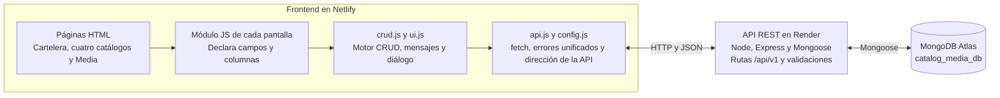

# Sustentación técnica: Catalog Media (frontend)

Documento de apoyo para la sustentación de la evidencia **EA2 · Proyecto Integrado II** (IU Digital). Explica el funcionamiento de las pantallas, las funciones implementadas y la integración entre el frontend y el backend.

---

## Resumen

El frontend es una aplicación web de seis pantallas en HTML, CSS y JavaScript puro que consume la API REST [Catalog-Media-API_REST](https://github.com/JorgeAHernandezC80/Catalog-Media-API_REST) para administrar géneros, directores, productoras, tipos y producciones audiovisuales. No usa frameworks ni paso de compilación; el uso de HTML semántico en lugar de ReactJS fue autorizado por el docente.

La solución se sostiene en tres ideas:

- **Pantallas:** una cartelera pública y cinco pantallas de gestión con listar, crear, editar y eliminar.
- **Funciones:** un solo motor CRUD (`crud.js`) para las cinco pantallas de gestión y una capa única de acceso a la API (`api.js`).
- **Integración:** el frontend publicado en Netlify llama por `fetch` al backend en Render (Node, Express y MongoDB Atlas), y muestra en pantalla los errores y reglas de negocio que valida el backend.

---

## Arquitectura



Cada capa solo habla con la de abajo: las pantallas usan el motor CRUD, el motor usa `api.js` y solo `api.js` hace peticiones HTTP al backend, que es el único que toca la base de datos. La dirección de la API vive únicamente en `config.js`.

---

## Pantallas y su funcionamiento

Son seis pantallas; cada una es un archivo `.html` con su módulo `.js`.

| Pantalla | Archivo | Qué hace la persona | Endpoints que usa |
| --- | --- | --- | --- |
| Cartelera | `index.html` + `inicio.js` | Ve las producciones como pósters, busca por título, filtra por tipo y género y abre la ficha de detalle | `GET /media`, `GET /generos`, `GET /directores` |
| Géneros | `generos.html` + `generos.js` | Lista, crea, edita y elimina géneros (nombre, estado, descripción) | `/generos` |
| Directores | `directores.html` + `directores.js` | Igual, con el campo `nombres` | `/directores` |
| Productoras | `productoras.html` + `productoras.js` | Igual, con nombre, estado, eslogan y descripción | `/productoras` |
| Tipos | `tipos.html` + `tipos.js` | Igual, sin campo de estado | `/tipos` |
| Media | `media.html` + `media.js` | Administra producciones con selectores de géneros, directores y productoras | `/media` y los cuatro catálogos anteriores |

### Cartelera (portada pública)

Al abrir la página pide `GET /media`, ordena las producciones de la más reciente a la más antigua y destaca la primera con su póster y una claqueta con sus datos. Debajo dibuja la grilla de pósters. La búsqueda ignora tildes y mayúsculas, y los filtros de tipo y género se construyen con los valores que traen las propias producciones. Un clic en un póster abre una ficha de detalle (`<dialog>`) con créditos, sinopsis, director, productora y enlace a la producción. Si el servidor tarda más de 6 segundos, avisa que se está encendiendo, porque el plan gratuito de Render lo apaga cuando no recibe visitas.

### Pantallas de gestión

Las cuatro pantallas de catálogo tienen la misma estructura: un formulario arriba y una tabla abajo. **Crear** envía `POST`, **Editar** carga el registro en el formulario y envía `PUT` al guardar, y **Eliminar** abre un diálogo de confirmación antes de enviar `DELETE`. Después de cada acción la tabla se vuelve a cargar desde la API y se muestra un mensaje de éxito o de error.

### Media

Es la pantalla más completa. El formulario pide serial, título, sinopsis, URL, portada, año de estreno y tipo (lista desplegable), más tres grupos de casillas: de 1 a 5 géneros, de 1 a 5 directores y de 1 a 5 productoras. Al llegar a 5 marcadas se bloquean las demás, y no deja guardar si no hay al menos una. Solo aparecen registros en estado Activo, igual que exige el backend. La tabla muestra los datos relacionados como etiquetas y tiene un filtro por género que envía `?genero=<id>`.

---

## Funciones implementadas

La lógica se reparte en módulos con una sola responsabilidad cada uno.

| Archivo | Función | Qué resuelve |
| --- | --- | --- |
| `config.js` | `API_URL` | Elige la API según el dominio: `localhost` o `127.0.0.1` usa el backend local; cualquier otro usa Render. También define `MAX_GENEROS`, `MAX_DIRECTORES` y `MAX_PRODUCTORAS` (5), iguales a los del backend |
| `api.js` | `listar`, `crear`, `actualizar`, `eliminar` | Son los únicos que usan `fetch`: `GET`, `POST`, `PUT` y `DELETE`. Arman la URL, envían el JSON y devuelven los datos |
| `api.js` | `ErrorApi`, `extraerError` | Unifican los tres formatos de error del backend (`{ message }`, `{ error }` y `{ message, errores: [...] }`) en un solo error con mensaje, código HTTP y lista de detalles |
| `api.js` | `pedir` | Ignora parámetros vacíos, y si `fetch` falla por red o CORS lanza un mensaje claro de que no hay conexión con la API |
| `crud.js` | `iniciarCrud(config)` | Motor genérico: carga la tabla, alterna entre modo crear y editar, envía el formulario, pide confirmación al eliminar y recarga. Cada pantalla solo declara campos y columnas |
| `ui.js` | `el`, `mostrarMensaje`, `mostrarError`, `confirmar`, `formatearFecha`, `insigniaEstado` | Crean elementos sin `innerHTML`, muestran avisos con `role="alert"`, abren el diálogo de confirmación y dan formato a fechas y estados |
| `media.js` | `crearSelectorMultiple` | Selector de casillas con mínimo 1 y máximo 5, creado una vez y reutilizado para géneros, directores y productoras |
| `media.js` | `cargarApoyo`, `leerFormulario`, `llenarFormulario` | Piden los cuatro catálogos en paralelo con `Promise.all`, arman el cuerpo JSON con listas de IDs y rellenan el formulario al editar |
| `inicio.js` | `cargarCartelera`, `filtrar`, `abrirDetalle`, `urlSegura` | Pintan la cartelera, aplican búsqueda y filtros, abren la ficha y solo aceptan enlaces `http` o `https` |

Dos decisiones de diseño conviene destacar. La primera es que un solo motor sirve a las cinco pantallas de gestión, así que arreglar o mejorar el CRUD se hace en un lugar. La segunda es de seguridad: todo texto que llega de la API se inserta con `textContent` o `append`, nunca con `innerHTML`, para que un nombre como `<script>` se vea como texto y no se ejecute.

---

## Integración entre frontend y backend

El frontend y el backend son dos aplicaciones separadas que se hablan solo por HTTP y JSON. El frontend está publicado en Netlify (`catalog-mediaapi.netlify.app`) y el backend en Render (`catalog-media-api-rest.onrender.com`), con los datos en MongoDB Atlas. Como los dominios son distintos, el backend habilita CORS con `app.use(cors())`; sin eso el navegador bloquearía las peticiones.

### Qué pasa cuando se guarda una producción

1. La persona llena el formulario de Media y pulsa **Crear**. `crud.js` valida con `reportValidity()` y llama a `leerFormulario`, que arma el JSON con las listas de IDs.
2. `crud.js` llama a `crear('media', cuerpo)` y `api.js` envía `POST /api/v1/media` con `fetch` y el encabezado `Content-Type: application/json`.
3. El backend valida con Mongoose: campos obligatorios, de 1 a 5 elementos sin repetir en cada lista y referencias en estado Activo. Si todo está bien guarda en Atlas y responde con el registro creado.
4. De vuelta en el frontend se limpia el formulario, se muestra "Registro creado" y la tabla se recarga con `GET /api/v1/media`. El backend devuelve las referencias "pobladas" (con nombre), por eso la tabla puede mostrar el director, la productora y los géneros en vez de IDs.

Cuerpo que envía el formulario de Media:

```json
{
  "serial": "PEL-0001",
  "titulo": "Viaje a las estrellas",
  "sinopsis": "Una tripulación explora los límites del universo conocido.",
  "url": "https://catalogo.ejemplo.com/peliculas/viaje-a-las-estrellas",
  "portada": "https://catalogo.ejemplo.com/portadas/viaje-a-las-estrellas.jpg",
  "anoEstreno": 2024,
  "generos": ["<id1>", "<id2>"],
  "directores": ["<idDirector1>", "<idDirector2>"],
  "productoras": ["<idProductora1>", "<idProductora2>"],
  "tipo": "<idTipo>"
}
```

### Reglas de negocio y errores visibles

El backend es quien valida; el frontend las hace visibles y evita los errores más comunes antes de enviar.

| Situación | Respuesta del backend | Qué ve la persona |
| --- | --- | --- |
| Datos inválidos (campo vacío, lista con más de 5, repetidos) | `400` con `message` y a veces `errores` | Aviso rojo con el mensaje y la lista de detalles |
| Serial o URL que ya existe | `409 Conflict` | Aviso rojo con el mensaje del backend |
| Eliminar un registro que usa alguna producción | `409 Conflict` | Aviso rojo con el mensaje del backend, que indica qué hacer |
| Servidor apagado o sin red | No hay respuesta | "No se pudo conectar con la API" con la pista de revisar `js/config.js` |

En el frontend, las casillas se bloquean al llegar al máximo de 5, las listas solo ofrecen registros Activos y la eliminación pide confirmación. Así el backend sigue siendo la última palabra, pero la mayoría de los errores se evitan antes de enviar.

### Ejecución local y publicada

`config.js` detecta el dominio: en `localhost` o `127.0.0.1` llama a `http://localhost:5000/api/v1` y en Netlify llama a Render. No hay que editar el código para cambiar de entorno. Los archivos deben abrirse con un servidor local como Live Server, porque los módulos de JavaScript no funcionan desde `file://`.

---

## Guion de demostración

Orden sugerido para mostrar la solución en vivo, de lo simple a lo completo, con la API encendida:

1. **Cartelera:** abrir el sitio publicado, mostrar la producción destacada, buscar un título sin tildes, filtrar por género y abrir una ficha de detalle.
2. **Catálogo:** entrar a Géneros, crear uno, editarlo y eliminarlo con la confirmación. Explicar que Directores, Productoras y Tipos usan el mismo motor `crud.js`.
3. **Media:** crear una producción con dos directores y dos productoras, mostrar que se bloquea la sexta casilla y que no deja guardar sin géneros.
4. **Reglas del backend:** repetir un serial para mostrar el aviso de conflicto, y borrar un género que usa una producción para mostrar que no se pueden dejar registros huérfanos.
5. **Integración:** abrir las herramientas del navegador, pestaña Red, y mostrar el `POST /api/v1/media` con su JSON y la respuesta, y luego `js/api.js` y `js/config.js` en el código.
6. **Entornos:** explicar que el mismo código usa el backend local en `localhost` y el de Render en Netlify.
